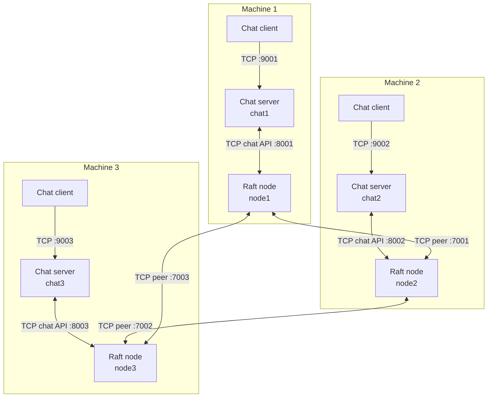
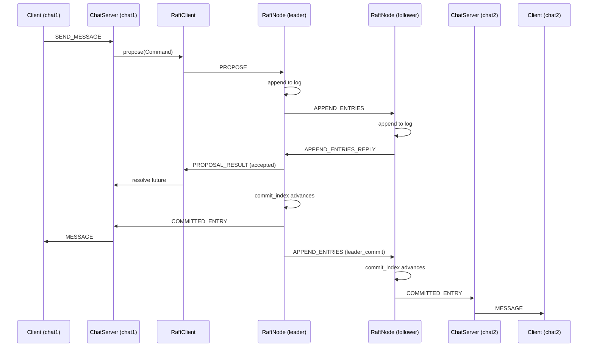
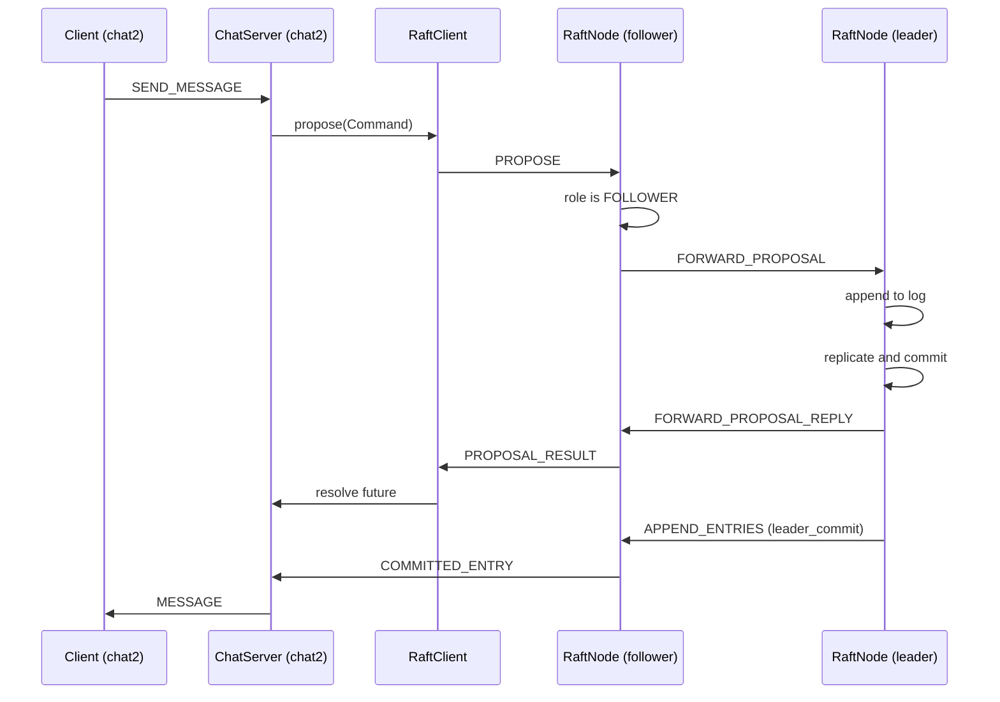

# Architecture

A distributed group chat built on a from-scratch Raft implementation. Every
participant machine runs two processes, a chat server and a Raft node, and all
state is held in memory.

## Processes and connections

Three connection types exist.

1. **Chat client to chat server.** A plain request and response protocol. The
   client sends SEND_MESSAGE. The server sends MESSAGE or ERROR.
2. **Chat server to its local Raft node.** The chat API. The chat server sends
   PROPOSE and receives PROPOSAL_RESULT as the reply. The Raft node pushes
   COMMITTED_ENTRY without being asked.
3. **Raft node to Raft node.** The peer protocol. REQUEST_VOTE,
   REQUEST_VOTE_REPLY, APPEND_ENTRIES, APPEND_ENTRIES_REPLY, and the two
   forwarding messages FORWARD_PROPOSAL and FORWARD_PROPOSAL_REPLY.

Each chat server is pinned to exactly one Raft node, and that pairing comes from
the configuration file. A chat server never talks to a remote Raft node.

## Message lifecycle

The path a chat message takes from one client to every other client.

1. A client sends SEND_MESSAGE to its chat server.
2. `ChatServer.handle_client_message` converts it with `message.to_command` and
   calls `ChatServer.propose_message`.
3. `ChatServer.propose_message` calls `RaftClient.propose`, which sends a
   PROPOSE over the chat API.
4. `ChatApiServer` receives the PROPOSE and calls `RaftNode.propose`.
5. `RaftNode.propose` checks its role.
   - If it is the **leader**, it appends the entry to its log and starts
     replication.
   - If it is a **follower**, it forwards the command to the leader with
     `PeerClient.send_forward_proposal`. The leader appends it and replies with
     a `ProposalResult`.
6. The leader sends APPEND_ENTRIES to every peer. Each follower appends the
   entry and replies with an APPEND_ENTRIES_REPLY.
7. Once a majority has acknowledged the entry, `RaftNode.advance_commit_index`
   moves `commit_index` forward.
8. `RaftNode.apply_committed_entries` applies every newly committed entry and
   calls `ChatApiServer.notify_committed_entry` for each one.
9. `ChatApiServer` pushes a COMMITTED_ENTRY to its chat server.
10. `ChatServer.handle_committed_entry` converts the entry with
    `message.message_from_entry` and then calls `ChatServer.broadcast_message`.
11. Every connected chat client receives a MESSAGE.

Note that step 5 returning `accepted=True` means the entry was appended to the
leader's log, not that it is committed. The chat server broadcasts only in step
10, after the commit.

The chat server keeps no history. It is a relay between its clients and its Raft
node, so each client builds its own view of the conversation from the stream.

## Message flow, step by step

The same lifecycle as a sequence diagram, showing which process holds the
message at each moment.

## When the proposal reaches a follower

A chat server is pinned to one Raft node, and that node might be a follower.
Only one of the three nodes is the leader. The forwarding path handles this.

## Known limitations

This is a prototype, so several things the Raft may require are absent.
Main focus is to keep shared distributed state, synchronization
and consistency, and consensus between Raft nodes.

- **No persistence.** `currentTerm`, `votedFor`, and the log are held in memory only.
- **No log compaction.** There is no snapshotting, so the log grows without bound.
- **No replay for a reconnecting chat server.** COMMITTED_ENTRY messages are pushed to whoever is connected at the time. A chat server that was down misses them, and because the server keeps no history, a client that connects later sees only messages sent after it connected.
